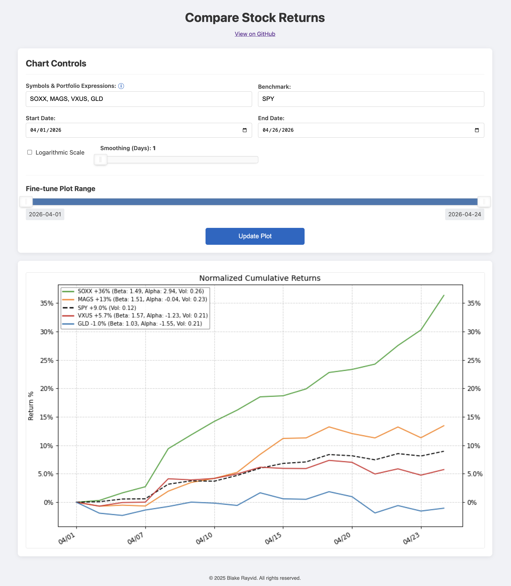

# Compare Stock Returns

A high-performance Flask web application to compare the historical total returns of publicly traded securities, simulated savings rates, and custom portfolios against a benchmark.

View the live project here: **[stocks.blakerayvid.com](https://stocks.blakerayvid.com)**

## Features

*   **Total Returns with Automatic Dividend Reinvestment:** All historical asset returns automatically factor in dividend distributions and stock splits (`auto_adjust=True`), reflecting true compounding performance.
*   **Compare Multiple Assets:** Plot and evaluate the performance of individual stock, ETF, crypto, and commodity symbols (e.g., `GOOGL, AAPL, BTC-USD, GLD`).
*   **Create and Compare Rebalanced Portfolios:**
    *   **Equal-Weighted:** `(AAPL, GOOG, MSFT)`
    *   **Custom-Weighted:** `(0.6*SPY, 0.4*TLT)`
    *   **Partially-Weighted:** Unweighted tickers automatically split any remaining weight evenly (e.g., `(0.5*VTI, VOO, QQQ)`).
*   **Quarterly Rebalancing:** Multi-asset portfolios model quarterly rebalancing back to target weights across time.
*   **High Yield Savings Simulation:** Compare equity performance against a risk-free baseline by toggling a compounding cash savings yield (e.g., `4.5% APY`), calculated on daily calendar compounding.
*   **Benchmark Relative Comparisons:** Benchmark against any symbol (defaults to `SPY` for the S&P 500).
*   **Interactive Controls & Fine-Tuning:**
    *   Download historical data across up to 20 years.
    *   Non-destructive date range slider (`noUiSlider`) to pan and zoom into specific market cycles without refetching.
    *   Adjustable rolling-average smoothing window (1 to 90 business days).
    *   Logarithmic scale toggle for geometric percentage gains.
*   **Performance & Risk Metrics:** In-chart legend displays cumulative percentage returns alongside key risk statistics:
    *   **Alpha:** Annualized excess return relative to the benchmark.
    *   **Beta:** Volatility sensitivity relative to benchmark fluctuations.
    *   **Vol (Historical Volatility):** Annualized standard deviation of daily returns.
*   **Resource Protection & Production-Ready:**
    *   **Rate Limiting:** Built-in IP rate limiting (`Flask-Limiter`) to prevent denial-of-service and bot abuse.
    *   **Memory Controls:** Bounded in-memory cache thresholds to prevent OOM spikes on container platforms like Railway.
    *   **Response Compression:** Gzip/Brotli payload compression via `Flask-Compress`.

## Tech Stack

*   **Backend:** Python 3, Flask
*   **Data Retrieval:** `yfinance`
*   **Data Science & Computation:** `pandas`, `numpy`
*   **Plotting & Rendering:** `matplotlib` (Agg headless backend)
*   **Frontend:** Semantic HTML5, CSS3, Vanilla JavaScript
*   **UI Components:** `noUiSlider`
*   **Caching & Optimization:** `Flask-Caching`, `Flask-Compress`, `Flask-Limiter`
*   **WSGI Server:** `gunicorn`

## Project Structure

```
stock-returns/
├── app.py             # Main Flask application logic & calculations
├── static/            # Static assets (robots.txt, favicon, sitemap)
│   ├── favicon.ico
│   ├── llms.txt
│   └── robots.txt
├── templates/         # Jinja2 templates
│   └── index.html
├── requirements.txt   # Python package dependencies
└── README.md          # Project documentation
```

## Setup and Installation

1.  **Clone the repository:**
    ```bash
    git clone https://github.com/brayvid/stock-returns.git
    cd stock-returns
    ```

2.  **Create and activate a virtual environment:**
    ```bash
    python3 -m venv .venv
    source .venv/bin/activate  # On Windows: .venv\Scripts\activate
    ```

3.  **Install dependencies:**
    ```bash
    pip install -r requirements.txt
    ```

## Running the Application

1.  **Ensure your virtual environment is active.**
2.  **Run the local development server:**
    ```bash
    python app.py
    ```
3.  **Open your browser** and visit `http://127.0.0.1:5001/`.

### Production Deployment (e.g., Railway, Render, Fly.io)

For production, run the application using Gunicorn with worker threads to maintain a low RAM footprint:

```bash
gunicorn --workers 2 --threads 4 --timeout 60 app:app
```

## How to Use

1.  **Enter Symbols & Portfolios:** Enter comma-separated assets or portfolio expressions into the main input field:
    *   **Single Assets:** `AAPL, MSFT, GOOGL`
    *   **Equal-Weighted Portfolio:** `(NVDA, AMD, INTC)`
    *   **Custom-Weighted Portfolio:** `(0.6*SPY, 0.4*TLT)`
    *   **Mixed Portfolios & Assets:** `(0.5*VTI, 0.5*VXUS), QQQ, GLD`
2.  **Set a Benchmark:** Enter a benchmark ticker (e.g., `SPY` or `QQQ`).
3.  **Pick Date Ranges:** Choose start and end dates.
4.  **Optional Toggles:**
    *   **Logarithmic Scale:** Useful for visualizing multi-decade or high-growth compound charts.
    *   **Include High Yield Savings:** Adds a compounding cash yield line for comparison.
    *   **Smoothing:** Apply a rolling moving average to filter daily market noise.
5.  **Fine-tune Date Range:** Use the interactive bottom slider to zoom into specific date intervals instantly without downloading data again.

## Example


---
<p align="center">&copy; Copyright 2026 <a href="https://blakerayvid.com">Blake Rayvid</a>. All rights reserved.</p>